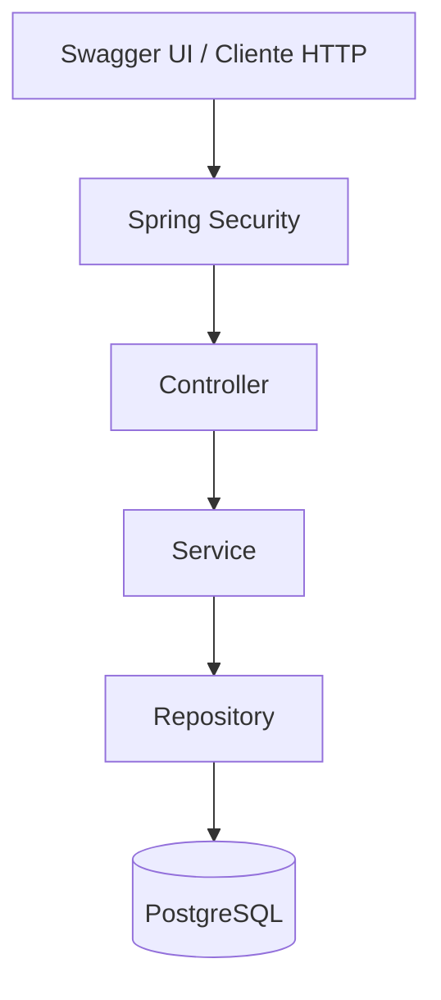
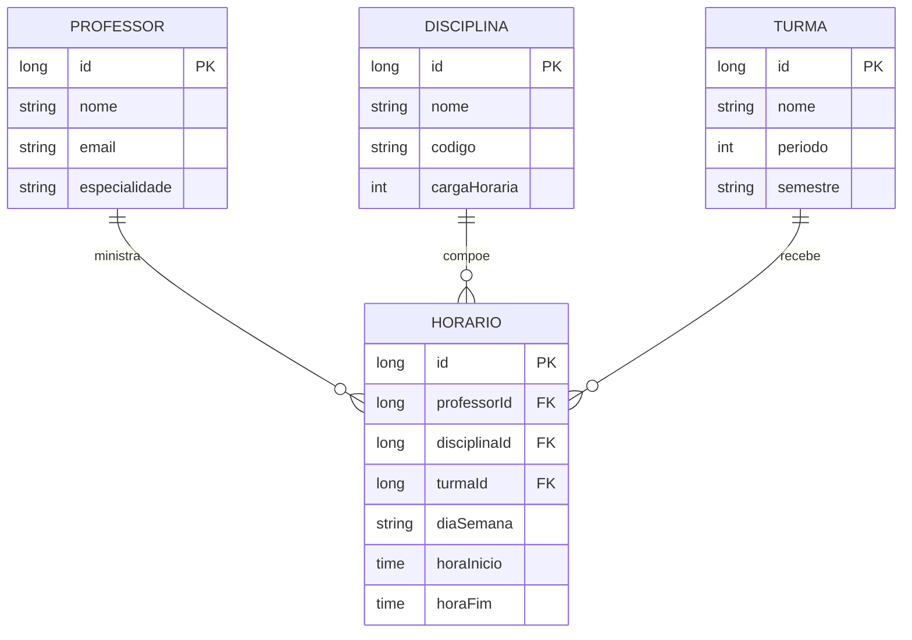

# Arquitetura

A aplicação utiliza Spring MVC para exposição de recursos REST, com separação entre transporte HTTP, regras de negócio e persistência.

## Responsabilidades

- controller: endpoints e códigos HTTP.
- dto: contratos de entrada e saída.
- service: validações de negócio e transações.
- repository: acesso a dados via Spring Data JPA.
- model: entidades persistentes.
- config: configuração da aplicação.
- exception: tratamento centralizado de erros.

## Modelo preliminar

## Decisões iniciais

PostgreSQL será utilizado para persistência, Flyway para versionamento do esquema e Bean Validation para validação dos contratos. Credenciais serão fornecidas por variáveis de ambiente. A documentação OpenAPI será utilizada para demonstrar as operações.

As decisões acima descrevem a arquitetura planejada, não funcionalidades já implementadas.
